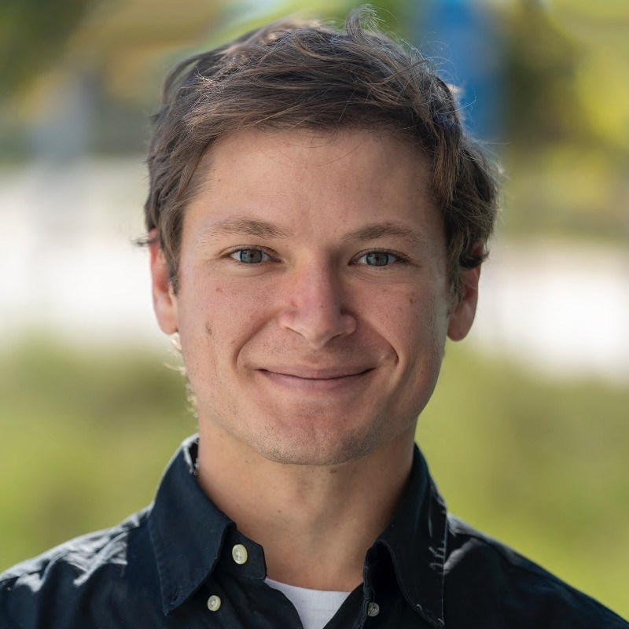

```{=html}
<div class="about-grid">
  <div>
    
  </div>
  <div>
    <p>
      I am an aspiring marine scientist drawn to the observational side of ocean science, from autonomous platforms like ocean gliders to the view of the ocean offered by satellite and remote sensing data. Having lived and worked at sea since joining the Navy at 18, I have found myself continually pulled toward oceanographic research and the instruments and platforms that make it possible.
    </p>
    <p>
      Over the past decade, I have had the opportunity to work on both sides of marine research: conducting oceanographic research at sea as a Marine Science Technician aboard the R/V Atlantic Explorer, and supporting ocean observation efforts through Running Tide, a carbon-sequestration startup, and the Ecosystem Modeling department at Bigelow Laboratory for Ocean Sciences as a student intern.
    </p>
    <p>
      This portfolio brings together a selection of oceanographic research projects that reflect that interest, from the autonomous platforms and remote sensing data that observe the ocean to the broader systems and processes they help reveal.
    </p>

    <div class="about-links">
      <a href="mailto:jace.innis22@gmail.com" class="btn-primary">Email Me</a>
      <a href="https://github.com/JaceInnis" target="_blank" class="btn-secondary">GitHub Profile</a>
      <a href="MarineScienceTechnicianMaster.pdf" target="_blank" class="btn-secondary">Resume</a>
    </div>
  </div>
</div>
```

 
 

 
 
 
 
 
 
 
 